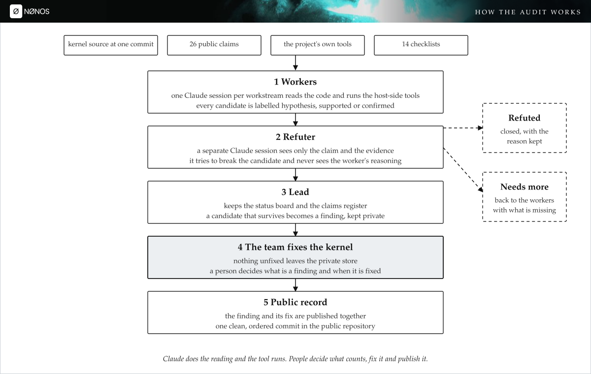
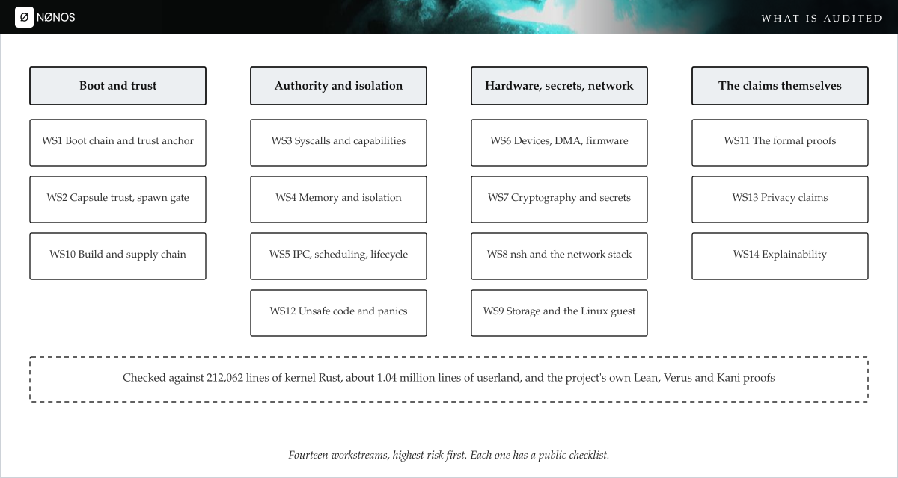
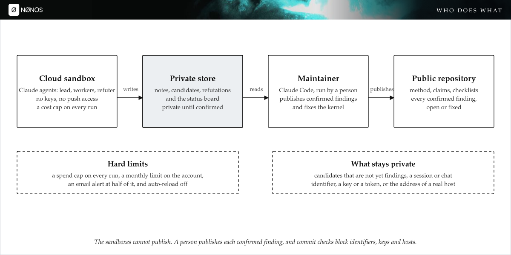
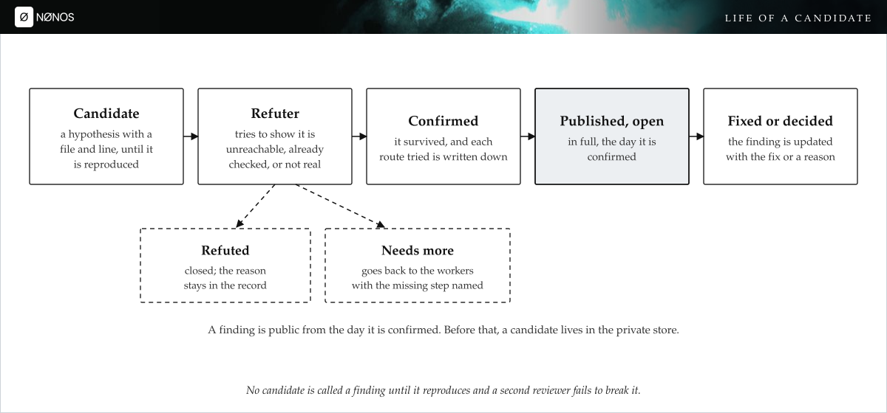

# auditing

A public security audit of the [NØNOS microkernel](https://github.com/NON-OS/microkernel): the method, the tools, the claims under test and, once each is fixed, the findings.

**Status.** The audit started on 2026-11-17. The method, the tooling and the claims register are public, the first workstream (syscalls and capabilities) has been run twice, and no finding has been published. [docs/status.md](docs/status.md) has the day's log and the numbers.

This is a first-party audit, done by the project's own team. It is not independent and does not replace an independent audit. What it offers is that the method, the tools and the results are open to be checked.

## How it works



Claude does the reading, the tool runs and the first write-up. People decide what counts, fix the kernel and publish. A second Claude session, the refuter, sees only the claim and the evidence and tries to break each candidate. Nothing unfixed leaves the private store.

- A candidate becomes a finding only by reproduction, or a complete chain from attacker to effect, and only after a second reviewer fails to break it.
- Nothing unfixed is published. [`scripts/leak_guard.py`](scripts/leak_guard.py) and [`scripts/validate_findings.py`](scripts/validate_findings.py) fail a change that adds it.
- Every statement about the code cites a source location, and [`scripts/check_citations.py`](scripts/check_citations.py) checks that it exists at the audited commit.
- No report says a component is secure. It says what was tested and what was not.

## What is audited



## Who does what



## What happens to a suspicion



Every finding is published here, with its evidence, after the maintainers have fixed it, accepted the risk or disputed it. [docs/disclosure.md](docs/disclosure.md) has the rules.

## Start here

| If you want to | Read |
|---|---|
| Know what is audited and how it is built | [docs/system-model.md](docs/system-model.md), [docs/scope.md](docs/scope.md) |
| See who the audit assumes attacks | [docs/threat-model.md](docs/threat-model.md) |
| Bring an audit, fuzzing or verification tool | [docs/pipeline.md](docs/pipeline.md), [docs/disclosure.md](docs/disclosure.md) |
| Check a public claim | [docs/claims.md](docs/claims.md), [`claims/`](claims/) |
| Report a vulnerability | [SECURITY.md](SECURITY.md) |
| See how the AI assistant is used | [docs/ai-use.md](docs/ai-use.md) |

## In the repository

| Path | What it holds |
|---|---|
| [`docs/`](docs/README.md) | Scope, method, system model, threat model, severity, disclosure, tools, claims, status |
| [`checklists/`](checklists/README.md) | One checklist per workstream: the bug classes to look for and the evidence to keep |
| [`claims/`](claims/README.md) | The claims register |
| [`findings/`](findings/README.md) | The finding schema, the template and the published findings |
| [`reports/`](reports/README.md) | Published reports |
| [`routines/`](routines/README.md) | The prompts that run the audit in cloud environments |
| [`scripts/`](scripts/) | The checks, the measurements and the script that publishes a fixed finding, with tests in [`tests/`](tests/) |
| [`targets/`](targets/targets.toml) | The audited tag and branch, and the commit the docs were last verified against |

## Checks

```bash
make check                                 # style, links, findings, claims, leaks, tests
make citations KERNEL_DIR=../microkernel   # every kernel: citation resolves in a kernel checkout
```

`make check` needs only Python 3. The citation check needs a checkout of the kernel at the commit in [`targets/verified-at.txt`](targets/verified-at.txt).

## Licenses

Code (`scripts/`, `tests/`, `routines/`, `.github/`, `Makefile`, the finding schema) is [Apache-2.0](LICENSE). Writing and data (`docs/`, `checklists/`, `claims/`, `findings/`, `reports/`, this file) are [CC BY 4.0](LICENSE-docs). Use any of it, in your own audits too, with attribution.
