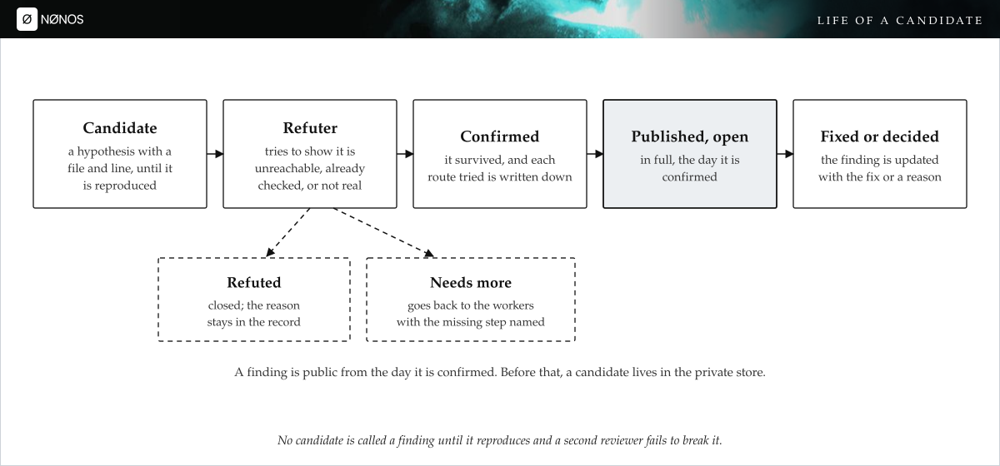

# Method

## Phases

| Phase | Work | Output |
|---|---|---|
| 0. Baseline | Resolve and record the commits. Build the targets. Run the project's own checks. Measure size, `unsafe` use, assembly and vendored code. Check every citation in the project's docs | `reports/<id>/baseline.md` |
| 1. Model | Write the attack surface from the code, not from the documentation | [system-model.md](system-model.md), [threat-model.md](threat-model.md) |
| 2. Review | Work through the checklists, highest risk first | candidate findings, private |
| 3. Test | Boot in QEMU with a software TPM. Inject faults. Fuzz parsers and system-call entry points | harnesses here, results in the private notes |
| 4. Verify | A second reviewer tries to refute every candidate from scratch | findings, and a count of candidates dropped |
| 5. Report | Write the report and the retest plan. Tell the maintainers. Publish after the fix | `reports/<id>/` |

Two workstreams run beside the technical ones from phase 1 to the end: claims ([claims.md](claims.md)) and explainability ([explainers.md](explainers.md)). A report is complete only when both are.

A critical finding stops the work and is reported to the maintainers the same day.

## Evidence

Every statement in a report is one of three kinds and says which:

- **Confirmed.** It was reproduced, and the steps are in the report.
- **Supported.** It was traced through the code, with file and line at the recorded commit, and not reproduced.
- **Hypothesis.** A lead that was not resolved. A hypothesis is not a finding and is not scored.

A finding needs a reproduction, or a complete chain from an attacker's capability to its effect with the preconditions written down. Every code reference is a `kernel:` citation that `scripts/check_citations.py` can check.

## Refutation

A candidate does not become a finding because the reviewer who found it believes it. A second reviewer, who has not seen the first reviewer's reasoning, is given the claim, the commit and the evidence file. They try to show that the code is unreachable by the stated adversary, that a precondition cannot hold, that an existing check already stops it, or that the evidence does not reproduce. A candidate that survives is a finding. One that fails is dropped, and the report states how many were dropped and why, so a reader can judge the false-positive rate.

## Dynamic testing

- A QEMU image built from the pinned commit, with a software TPM, scratch keys and a serial console.
- Fault injection at the boundaries: a TPM that returns errors or lies, truncated and oversized trailers, firmware tables with bad lengths, devices that return malformed data.
- Fuzzing with structure-aware harnesses for parsers that build on the host, and a guest-side harness for the kernel's entry points. Crashes are minimised and triaged before they are reported.
- Mutation of the project's own controls with `kernel:tools/nonos-mutant`: remove a control, and check that the project's checks notice.

The tools are listed in [pipeline.md](pipeline.md).

## Reviewing the project's proofs

The project ships machine-checked proofs. The audit does not repeat them. It builds a table of what each proof states, which code it covers, what it assumes and what it leaves out, and reports any claim in the documentation that the proofs do not support.

## Reproducibility

Each harness and script runs from a clean machine against a pinned commit, and its documentation says how. A result that cannot be reproduced is labelled as such.

## Independence

This is a first-party audit. Each report names who did the work, including the use of an AI assistant ([ai-use.md](ai-use.md)), and says that the work is not independent.
