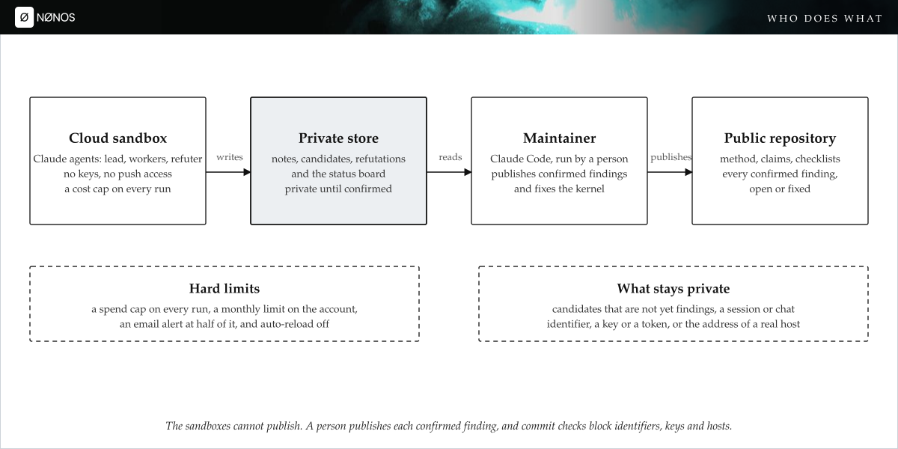

# Tools and pipeline

The audit uses three groups of tools: checks the project already runs in CI, tools in the project's tree that the audit runs and extends, and tools the audit adds. Each row says which group it is in, so a reader can tell what was already true from what this audit brings.

## Already running in the project's CI

| Tool | What it covers | Workflow |
|---|---|---|
| Lean proofs, including the extraction of kernel functions | properties of kernel functions | `kernel:.github/workflows/verify.yml` |
| Verus | capability model theorems | `kernel:.github/workflows/verify.yml` |
| Kani | bounded model checking over 17 proof crates | `kernel:.github/workflows/verify.yml` |
| cargo-fuzz | nightly runs over the parsers of untrusted input, 30 minutes per target, with the targets listed in `kernel:fuzz/targets.json` | `kernel:.github/workflows/fuzz.yml` |
| cargo-audit and cargo-deny, run by `nonos-verify supply-chain` | dependency advisories, licence rules and the duplicate dependency surface | `kernel:.github/workflows/ci-supply-chain.yml` |
| Reproducibility | three machines build the compiled artifacts from one commit with no shared cache, and `nonos-verify reproducible` fails unless all name the same bytes. The sealed image is not compared, by design | `kernel:.github/workflows/ci-reproducible.yml` |
| Cross-capsule isolation | one capsule against another over the surface rules, guard pages, driver grant windows, the system-call capability table and user-copy bounds | `kernel:.github/workflows/ci-isolation.yml` |
| Adversarial tamper test | `nonos-verify adversarial` flips bits in a valid signed capsule, expires its windows, truncates it and cross-binds it, and asserts every one is rejected | `kernel:.github/workflows/ci-adversarial.yml` |
| SBOM | a CycloneDX bill of materials computed from the pins | `kernel:tools/nix/sbom.nix` |

## The project's own claim-checking tools, run by the audit

The project documents these in `kernel:docs/security/checking-the-claims.md`. The audit runs every one on both targets in phase 0, keeps the output, and extends them where a claim needs more than they test.

| Tool | Claim it tests |
|---|---|
| `kernel:tools/nonos-cap-audit`, `kernel:scripts/cap_audit.py`, `kernel:scripts/check_cap_parity.py`, `kernel:scripts/check_unenforced.py` | every capability and control is enforced |
| `kernel:tools/nonos-assumptions` | the assumption register is complete |
| `kernel:tools/nonos-mutant` | a removed control is noticed |
| `kernel:tools/nonos-pcap-egress`, `kernel:tools/nonos-egress-audit` | a boot sends nothing unexpected |
| `kernel:tools/nonos-amnesic-check` | an amnesic boot writes nothing |
| `kernel:tools/nonos-flip-byte` | a tampered artifact is refused |
| `kernel:tools/nonos-proof-coverage` | what the proofs cover |
| `kernel:tools/nonos_system_map.py` | the whole-image report and the authority map |

## Added by this audit

| Tool | What it does | Status |
|---|---|---|
| `scripts/check_citations.py` | Checks that cited source locations exist, in this repository's docs and in the kernel's | built, tested |
| `scripts/metrics.py` | Sizes the tree: lines, `unsafe`, inline assembly, allowances, lock-file packages | built, tested |
| `scripts/validate_claims.py` | Holds the claims register to its evidence rules | built, tested |
| `scripts/validate_findings.py` | Holds published findings to the disclosure rules | built, tested |
| `scripts/leak_guard.py` | Keeps keys, identifiers and real addresses out of this repository | built, tested |
| `scripts/publish_finding.py`, `scripts/render_findings.py` | Publish a confirmed finding, update it when it is decided, and keep its page and the index in step with the JSON | built, tested |
| The kernel's own fuzz targets, run as a campaign | Every shipped target in rounds, the corpus kept between runs, every crash minimised and traced (WS18) | running |
| Miri | Undefined behaviour in `unsafe` code, on every host-testable crate (WS19) | running |
| AddressSanitizer, UndefinedBehaviorSanitizer, loom | Memory errors and ordering bugs in the host tests (WS19) | running |
| Clippy at its strictest, cargo-geiger | Lints, and an inventory of `unsafe` per crate and dependency (WS19) | running |
| cargo-mutants | Which checks the tests do not really pin (WS19) | running |
| Semgrep, CodeQL | Static analysis with security rule sets (WS19) | running |
| cargo-audit, cargo-deny, OSV-Scanner, OpenSSF Scorecard | Advisories and practices, run independently of the project's CI (WS19) | running |
| Clang static analyzer, cppcheck, a constant-time test | The vendored C and assembly, and the ML-DSA-65 signing path (WS19) | running |
| Project Wycheproof and NIST ACVP vectors | Known-bad cases for Ed25519, ChaCha20-Poly1305, P-256, HKDF and ML-DSA-65 (WS19) | running |
| lean4checker | Re-checks the Lean proofs independently (WS19) | running |
| QEMU with a software TPM | Boots of the published image and of a development build of the audited commit, and tests inside them | in progress |
| Structure-aware syscall fuzzer | Reaches the kernel's entry points from inside a running system | to build once the development build boots |
| Ghidra and objdump on the sealed bytes | That wipes survive the optimiser, and that secret-dependent code runs in constant time | to run |

Every tool run is recorded with its version and exact command. A tool hit is a lead: it is confirmed in the code or dismissed with a reason before anything reaches a finding.

## How the work is run

The audit is run by agents in isolated cloud sandboxes, each working on one workstream and writing to a private store. Candidate findings go through the refutation step in [method.md](method.md) before anyone reads them as findings.

## Tools from outside

A project that builds audit, fuzzing or verification tools is invited to run them against the kernel. A report goes to the maintainers first, by the route in [disclosure.md](disclosure.md). The audit credits the tool and its author in the finding.
