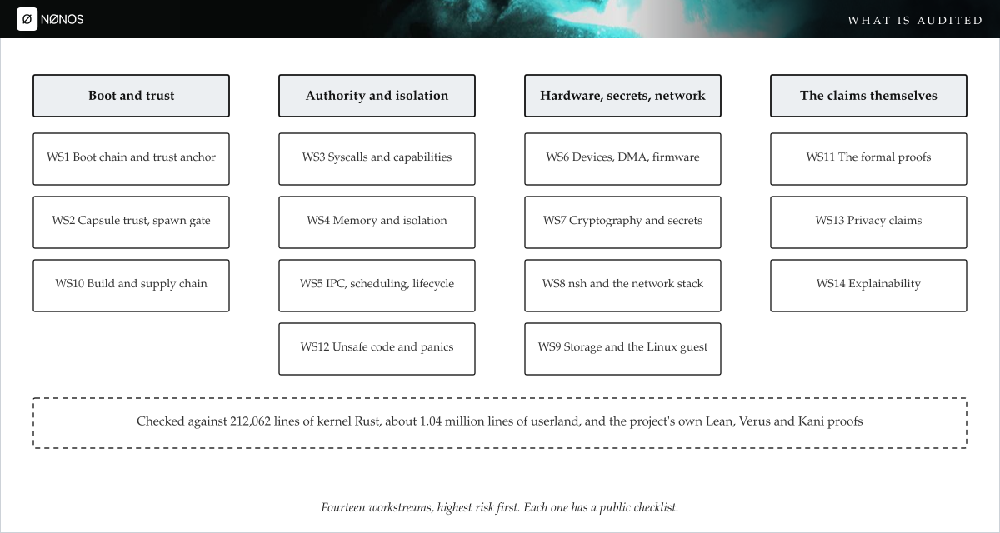

# Scope

## Target

The NØNOS microkernel, `NON-OS/microkernel`. Every engagement audits two things and every finding says which one it affects:

- the released tag, currently `v0.9.3.5`, which is the sealed release;
- the head of `main` when the engagement starts.

Both are resolved to full commit hashes at the start by `scripts/resolve_targets.py` and written into the report. A branch name is never a target. The commit the documents in this repository were last checked against is in `targets/verified-at.txt`.

## What is audited

Every directory of the kernel and the bootloader has an owning workstream, and each run records which files it read, traced or tested, so coverage can be measured and not assumed.

| Area | Workstream | Checklist |
|---|---|---|
| Boot chain and trust anchor | WS1 | [ws01](../checklists/ws01-boot-chain.md) |
| Capsule trust, enrolment and the spawn gate | WS2 | [ws02](../checklists/ws02-capsule-trust.md) |
| System-call layer and capabilities | WS3 | [ws03](../checklists/ws03-syscalls-capabilities.md) |
| Memory management and isolation | WS4 | [ws04](../checklists/ws04-memory-isolation.md) |
| IPC, scheduling and process lifecycle | WS5 | [ws05](../checklists/ws05-ipc-scheduling.md) |
| Devices, DMA and firmware | WS6 | [ws06](../checklists/ws06-devices-dma.md) |
| Cryptography and secrets | WS7 | [ws07](../checklists/ws07-crypto-secrets.md) |
| nsh/1 and the network stack | WS8 | [ws08](../checklists/ws08-nsh-network.md) |
| Storage, the data volume and the Linux guest | WS9 | [ws09](../checklists/ws09-storage-guest.md) |
| Build, supply chain and release | WS10 | [ws10](../checklists/ws10-build-supply-chain.md) |
| Review of the formal verification | WS11 | [ws11](../checklists/ws11-verification-review.md) |
| Unsafe code, panics and hygiene | WS12 | [ws12](../checklists/ws12-unsafe-hygiene.md) |
| Claims and privacy verification | WS13 | [ws13](../checklists/ws13-claims-privacy.md) |
| Explainability | WS14 | [ws14](../checklists/ws14-explainability.md) |
| The STARK proof system, at the commit the kernel pins | WS15 | [ws15](../checklists/ws15-stark-proof-system.md) |
| x86-64 architecture code | WS16 | [ws16](../checklists/ws16-x86-64-architecture.md) |
| Trusted capsules in user space | WS17 | [ws17](../checklists/ws17-trusted-capsules.md) |
| Fuzzing campaign | WS18 | [ws18](../checklists/ws18-fuzzing.md) |
| Open-source tool sweep | WS19 | [ws19](../checklists/ws19-tool-sweep.md) |

## Out of scope

- The closed-source products that run on NØNOS, and any hosted service built on them.
- Third-party services the project does not operate.
- Social engineering, and attacks that need physical destruction of hardware.
- Denial of service by an attacker who already holds a privileged capability, unless the project's documentation promises otherwise.

## Authorization

The founder and chief executive of NØNOS authorized this audit on 2026-11-17, including testing that tries to break the kernel: fault injection, fuzzing, exploit development and attempts to defeat the boot and capsule trust chain. The authorization covers builds of the kernel that the project controls, run in environments the project controls.

It does not cover third-party systems or services, the project's production hosts, or any real key. Those stay out of every test.

## Rules

1. The audited source is never modified. Test code lives in this repository or in the engagement's private notes.
2. Everything runs in environments the project controls: QEMU with a software TPM and scratch keys. No test touches a production host or a real key.
3. Findings are handled as set out in [disclosure.md](disclosure.md).
4. Each report lists what was not covered, and why.

## What a clean result means

If the work finds nothing in an area, the report says which methods were applied to it and for how long. It does not say the area is secure.
